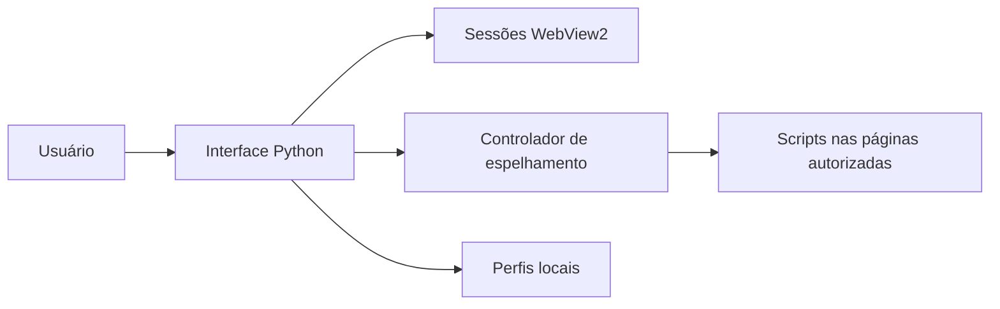

# ZasaBoard — guia para entender o código
Revisão documental: 13/11/2026. Código de referência: [e91c3731](https://github.com/lisarbjoao/ZasaBoard/tree/e91c3731da2ce9de4b8087e3726012ff9b4f7521). Inspeção estática de entradas, módulos e documentos; não é nova execução dos testes nem certificação de segurança.

## Produto e origem
Aplicativo desktop Windows com cartões de jogos, perfis persistentes, lives e espelhamento opt-in de cliques/rolagem. O código tem parentesco com Idleboard, mas o estado distribuído é identificado por BASE.json; não assumir que as duas árvores continuam iguais.

## Estrutura
| Caminho | Papel |
|---|---|
| [app/main.py](../app/main.py) | Coordena interface, cartões e navegação. |
| app/*_interface.py e app/layout.py | Telas e disposição dos cartões. |
| [app/core/browserman.py](../app/core/browserman.py) | Ciclo de vida das sessões WebView2. |
| [app/core/espelho.py](../app/core/espelho.py) e espelho_scripts.py | Controlador e scripts do espelhamento. |
| app/core/perfis.py e ambiente.py | Cadastro e diretórios locais. |
| packaging/ e [tools/build_beta.py](../tools/build_beta.py) | Iniciador, instalador, desinstalador e build. |
| [BASE.json](../BASE.json) | Versão/checkpoint e hashes de referência da exportação. |

No espelhamento, a página fornece eventos; o controlador valida formato/origem e identidade da sessão antes de coordenar cartões. O espelhamento é efêmero e interrompível: não é uma fila de execução persistente nem garantia de que telas de contas diferentes estejam alinhadas.

## Decisões e dados
A interface organiza cartões; o WebView mantém as páginas e suas sessões. Metadados de perfis e cookies são categorias distintas de dados locais e não devem entrar no Git. Empacotamento distribui runtime próprio, sem tornar necessário um Python global para o usuário final. A fonte canônica da aplicação fica em app/, não dentro do instalador.

Há divergência documental observada: README e BASE.json indicam beta.10; docs/estado.md ainda cita beta.9. Este guia não verifica a release publicada nem reescreve esse histórico; consultar o manifesto e conferir o pacote escolhido antes de apresentar uma versão.

## Trilha de estudo
Leia app/main.py → app/core/browserman.py → app/core/espelho.py → tests/test_espelho.py → tools/build_beta.py. Explique: o que inicia uma sessão? Quem valida um evento? O que o instalador inclui e o que fica fora?
Use [compilação](compilacao.md), [distribuição](distribuicao.md) e a CI para comandos e dependências. Os testes do repositório incluem espelhamento e distribuição; contas reais, estabilidade prolongada e desempenho exigem suas próprias evidências. Não executei builds ou testes nesta revisão documental.

## Como manter este guia
Ao mudar um fluxo, atualizar suas entradas, módulos, dados, falhas e testes neste guia no mesmo incremento. Registrar decisões relevantes e indicar o que foi efetivamente executado. Antes de apresentar, percorrer um caso concreto no código e conferir as pendências; ler o guia não substitui experimentar o produto.
